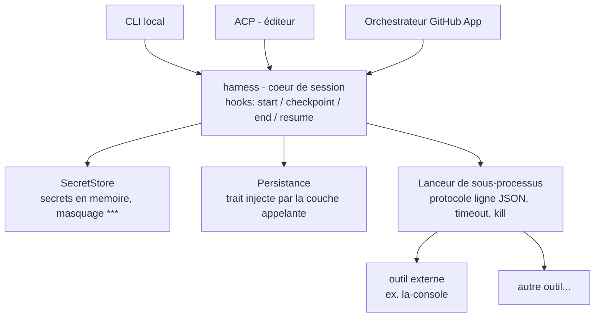

# Architecture du harness

Le harness n'est pas « une boucle qui exécute des commandes » : c'est un **cœur
de session** entouré de couches de transport optionnelles. La console
(`la-console`, repo séparé) n'est qu'un outil parmi d'autres, branché comme
binaire externe.

## Vue d'ensemble (diagramme)

## Le cœur (maison)

### Session + hooks

- `Session` : id, root du repo de l'agent, état courant.
- Cycle de vie émis via des hooks : `on_start`, `on_checkpoint`, `on_end`,
  `on_resume`.
- La **persistance est un trait injecté** par la couche appelante (CLI local,
  orchestrateur) : le cœur n'ouvre jamais de fichier lui-même.

### SecretStore

- Secrets chargés au lancement (env ou fichier de config local), gardés **en
  mémoire uniquement**, avec refresh automatique quand ils expirent.
- Toute sortie transmise à l'extérieur passe par le masquage (`***`).

### Lanceur de sous-processus

- Spawn d'un binaire externe, protocole **une ligne JSON en entrée, une ligne
  JSON en sortie**, timeout, kill propre du fils à la fin.
- Réponses mal formées = rejet fail-closed.
- Le stdin/stdout du fils appartiennent au protocole ; les secrets ne sont
  **jamais** passés par env ou argv.

## Couches de transport optionnelles

Aucune n'est obligatoire ; le cœur fonctionne sans.

| Couche | Rôle | Tech |
|---|---|---|
| CLI local | `le-harness run --repo <chemin>`, boucle interactive | clap |
| ACP | piloté comme agent depuis un éditeur (Zed...) | crate officielle `agent-client-protocol`, rôle `Agent` |
| Orchestrateur GitHub App | webhooks, jobs éphémères (remote) | reqwest + rustls côté harness |

## Règle d'indépendance

> Aucun `use la_console` nulle part. La console est invoquée comme **binaire
> externe** via le lanceur générique, jamais comme dépendance de code.
