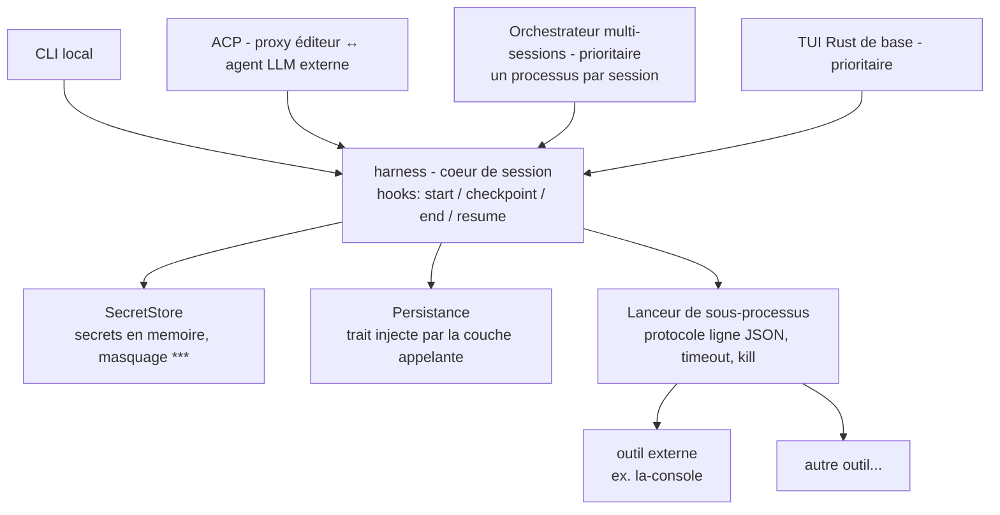

# Architecture du harness

Le harness n'est pas « une boucle qui exécute des commandes » : c'est un **cœur
de session** entouré de couches de transport optionnelles. La console
(`la-console`, repo séparé) n'est qu'un outil parmi d'autres, branché comme
binaire externe.

## Qui fait quoi (clarifié nov. 2026)

Deux « UI » différentes, à ne pas confondre :

| Côté | Contenu |
|---|---|
| **Agent externe** (hors harness) | boucle LLM (prompt / modèle / streaming), chat UI de l'agent, client ACP — tout ce qui « réfléchit » |
| **Harness** | cœur headless (session + politique + secrets + lanceur) + couches de transport optionnelles : stdio ligne-JSON, CLI `run`, **TUI (front local)**, **proxy ACP**, `serve` multi-sessions |

- La **TUI (étape 9)** est le front local du cœur headless — un « safe shell »
  interactif pour piloter le harness directement. Elle ne contient **ni boucle
  LLM, ni chat, ni client ACP** ; elle soumet des demandes d'outils au cœur et
  affiche les résultats masqués.
- Côté **ACP**, le harness joue le rôle **`Proxy`** (et non `Agent`) : il se
  branche entre l'éditeur (client ACP) et l'agent LLM externe, intercepte les
  appels d'outils, les exécute via la-console de façon confinée (politique du
  repo, masquage des secrets, phantom token). L'agent LLM (boucle + chat) reste
  entièrement externe — le harness ne parle jamais au modèle.

## Vue d'ensemble (diagramme)

## Le cœur (maison)

### Session + hooks

- `Session` : id, root du repo de l'agent, état courant.
- Cycle de vie émis via des hooks : `on_start`, `on_checkpoint`, `on_end`,
  `on_resume`.
- La **persistance est un trait injecté** par la couche appelante (CLI local,
  orchestrateur) : le cœur n'ouvre jamais de fichier lui-même.

### SecretStore

- Secrets chargés au lancement (env ou fichier de config local), gardés **en
  mémoire uniquement**, avec refresh automatique quand ils expirent.
- Toute sortie transmise à l'extérieur passe par le masquage (`***`).

### Lanceur de sous-processus

- Spawn d'un binaire externe, protocole **une ligne JSON en entrée, une ligne
  JSON en sortie**, timeout, kill propre du fils à la fin.
- Réponses mal formées = rejet fail-closed.
- Le stdin/stdout du fils appartiennent au protocole ; les secrets ne sont
  **jamais** passés par env ou argv.

### Proxy de credentials (broker)

- Le harness peut jouer le rôle de **reverse proxy local** pour les outils :
  l'outil ne reçoit qu'un *phantom token* de session ; le vrai secret, détenu
  uniquement par le harness, est injecté à la sortie vers la destination
  autorisée uniquement (pattern « phantom token », inspiré de nono).
- Concerne notamment la-console et tout outil ayant besoin d'un credential réseau.

## Couches de transport optionnelles

Aucune n'est obligatoire ; le cœur fonctionne sans.

| Couche | Rôle | Tech |
|---|---|---|
| CLI local | `le-harness run --repo <chemin>`, boucle interactive | clap |
| TUI Rust de base | interface terminal standard au-dessus du cœur (prioritaire) | `ratatui` + `crossterm`, boucle synchrone (voir [ecosystem.md](ecosystem.md)) |
| ACP | **proxy** entre l'éditeur (client ACP, ex. Zed) et l'agent LLM externe : interception des appels d'outils, exécution confinée, masquage | v1 : rôle `Proxy` maison synchrone au-dessus du protocole ligne-JSON ; SDK officiel `agent-client-protocol` (async, `conductor`/Proxy) si besoin mesuré |
| Orchestrateur multi-sessions | plusieurs sessions en parallèle, un processus par session (local-first) ; GitHub App remote en v2 par-dessus | `std::process` + threads + ligne-JSON (voir [ecosystem.md](ecosystem.md)) |

> **Concurrence bornée, sans runtime async** : multi-sessions = un processus par
> session, appels d'outils parallèles = threads bornées (`--max-parallel-tools`) ;
> aucun runtime async dans aucune couche en v1 ([ecosystem.md](ecosystem.md) §8).

## Règle d'indépendance

> Aucun `use la_console` nulle part. La console est invoquée comme **binaire
> externe** via le lanceur générique, jamais comme dépendance de code.
